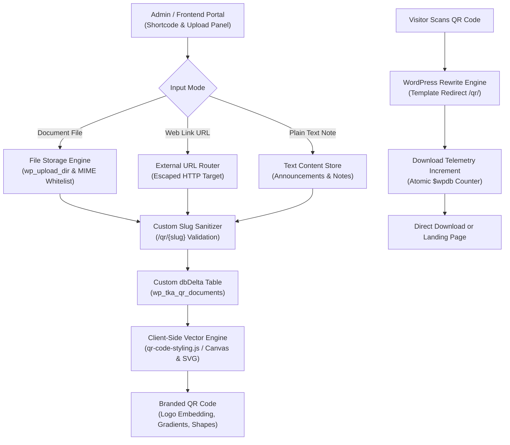

# 🔲 Dynamic Document & Link QR Portal for WordPress

<p align="left">
  
  
  
  
  
</p>

A high-performance WordPress plugin combining interactive client-side vector QR code generation (Canvas & SVG) with custom URL shortlink routing, secure document hosting, and real-time download telemetry. Designed for organizations, conferences, and businesses that need branded, trackable QR codes and shortlinks with zero external API dependencies.

> 💡 **Community Edition (Developer Preview):** Features the full interactive vector styling studio and shortlink redirection engine, capped at **10 active QR codes / documents**. For unlimited shortlinks, bulk CSV import, and white-label custom domain mapping, see the [Pro Edition Roadmap](#-community-vs-pro-edition).

---

## 🏗️ System Architecture



---

## ✨ Key Engineering Features

### 1. Interactive Client-Side Vector Styling (`qr-code-styling.js`)
- **Real-Time Canvas & SVG Rendering:** Renders vector QR codes dynamically in the browser without server CPU or GD image generation bottlenecks.
- **Custom Aesthetic Controls:**
  - Dot patterns (Dots, Rounded, Classy, Square).
  - Corner square & corner dot custom shapes.
  - Linear and radial color gradients.
  - Centered brand logo watermarking with automatic error-correction level adjustment (`Level H`).

### 2. High-Speed URL Shortlink Routing
- Implements custom WordPress rewrite rules (`add_rewrite_rule`) to map clean `/qr/{slug}` requests directly without creating dummy WordPress posts or pages.
- Intercepts resolution at `template_redirect` for sub-millisecond redirect and download delivery.

### 3. Secure Multi-Type Document Hosting
Supports three distinct payload categories:
1. **Document Files:** PDF, DOCX, PPTX, XLSX, and images stored securely in WordPress uploads.
2. **Dynamic Web Links:** Outbound URL shortlinks with live destination editing.
3. **Plain Text / Announcements:** Instant mobile-friendly reading pages for memos and notices.

### 4. Enterprise Security & Sanitization
- **Nonced Endpoints:** All generation and deletion calls are protected by `wp_create_nonce` and `check_ajax_referer`.
- **Slug Sanitization:** Enforces strict alphanumeric/hyphen filtering with unique database index collision detection.
- **Security PIN Gate:** Optional PIN lock to protect public or shared upload portals from unauthorized uploads.

---

## 📊 Community vs. Pro Edition

| Feature | ⚡ Community Edition (This Repo) | 🚀 Pro Enterprise Edition |
| :--- | :--- | :--- |
| **Active Shortlinks & QR Codes** | Up to 10 active items | **Unlimited** |
| **Live Vector Customizer** | Full Access (Canvas & PNG export) | **Full Access + 300 DPI Print SVG / PDF** |
| **Shortlink Routing** | Native `/qr/{slug}` | **Custom Multi-Domain White-Labeling** |
| **Download Analytics** | Aggregate Download Counter | **Visitor Device, OS, Browser & Geo-Telemetry** |
| **Batch Generation** | Single creation | **Bulk CSV Import & Multi-QR Export (.zip)** |
| **Password-Protected Links** | Not included | **PIN / Password Gate per Link** |

---

## 🚀 Installation & Setup

1. **Clone or Download:**
   ```bash
   git clone https://github.com/solokool66/wp-document-qr-portal.git
   ```
2. **Deploy to WordPress:**
   Copy the `wp-document-qr-portal` folder into:
   ```text
   /wp-content/plugins/wp-document-qr-portal/
   ```
3. **Activate:**
   Go to your WordPress Admin Dashboard -> **Plugins** -> Activate **Dynamic Document & Link QR Portal**.
4. **Flush Permalinks (One-Time):**
   Navigate to **Settings -> Permalinks** and click **Save Changes** to register the `/qr/` rewrite rule.
5. **Frontend Display:**
   Use the shortcode `[tka_document_qr_portal]` on any page to display the user-facing upload and QR generator interface!

---

## ❓ Frequently Asked Questions (FAQ)

#### Q1: Does this require an external QR code API service?
> **No.** All QR codes are rendered 100% locally in the user's browser using client-side Canvas and SVG vector math. Zero external tracking, zero API keys, and zero subscription costs.

#### Q2: Can I change the destination of a QR code after it has been printed?
> **Yes.** Because the QR code points to your dynamic shortlink (`/qr/myslug`), you can update the destination file or URL at any time in your dashboard without reprinting the QR code.

#### Q3: How are file downloads tracked?
> Each access through the `/qr/` route triggers an atomic increment on the database index (`download_count`), giving you exact delivery totals for distributed documents.

---

## 👤 Author & Architecture

**Solomon, Kingsley Eze**  
*Software & Network Systems Engineer*  
- 💼 **LinkedIn:** [linkedin.com/in/solokool](https://www.linkedin.com/in/solokool/)  
- 🐙 **GitHub:** [@solokool66](https://github.com/solokool66)  
- 📧 **Email:** [solokool66@gmail.com](mailto:solokool66@gmail.com)  

---

## 📄 License
Licensed under the [GNU General Public License v2.0 or later](LICENSE).
